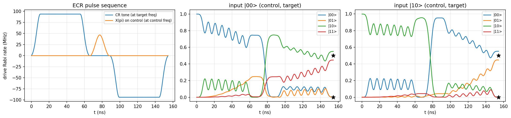

# Cross-resonance and echoed CR gate simulations

Two notebooks on modelling capacitively coupled transmons and driving a cross-resonance gate. I use these models to connect qubit frequencies and coupling rates with pulse behaviour and approximate layout targets.

## Start here

| Notebook | What it covers |
| --- | --- |
| [QuTiP-only CR/ECR workflow](notebooks/ECR_gate_qutip_simulation.ipynb) | Static spectrum, ZZ, CR rates, lab-frame checks, pulse calibration, leakage and ECR design-space scan |
| [Original scqubits + QuTiP tutorial](CR_gate_scqubits_qutip_tutorial_1.ipynb) | Transmon spectra, coupled Hamiltonian and a lab-frame CR pulse example |

The first notebook is the more complete design study. The original tutorial is retained at its existing path. Its last example uses a different parameter set from its opening design point; read each section’s parameters before comparing results.

## Example result

The supplied ECR example selects 4.9 and 5.0 GHz qubits, −300 MHz anharmonicities and 4 MHz exchange coupling. It gives an approximately 154 ns sequence and a coherent average gate fidelity of about 0.99685 after virtual-Z optimisation. Average leakage is about 5.7e-5. See the executed notebook and its [CSV export](notebooks/ecr_design_targets.csv) for the complete parameters.

These are three-level model results, not measured hardware performance. The computational-block fidelity includes leakage loss. The separate Lindblad example compares a single input state against coherent evolution; it is not a noisy average gate-fidelity calculation.



## Run

Create a Python environment, then:

```shell
python -m pip install -r requirements.txt
jupyter lab
```

Open a notebook and run it from the beginning. The ECR notebook uses GHz/ns and converts Hamiltonians to rad/ns. Qubit 1 is the control, qubit 2 the target; `J` is the exchange coefficient of `a1†a2 + h.c.`. The full calibration scan can take several minutes. CSV output is written to the notebook’s working directory.

The ECR workflow was rerun with the versions recorded in [VALIDATION.md](VALIDATION.md). Requirements describe compatible package ranges; they are not a lockfile for the older tutorial.

## Checks and limits

- Compare exact-cosine and Duffing static ZZ.
- Compare analytic CR rates with dressed-state matrix elements.
- Compare rotating-frame and lab-frame populations; the example differs by roughly one percent.
- Track leakage and inspect all four computational inputs.
- Distinguish ECR truth tables from the locally converted CNOT check.

The pulse model omits DRAG, rotary tones, drive crosstalk, readout resonators, thermal populations and detailed TLS/flux-noise models. Coupling capacitance exported for layout is an estimate requiring EM verification. No fabrication or experimental benchmark is claimed.

[Project explanation](https://mukul-quantum-researcher.github.io/projects/cr-ecr/) · [Portfolio](https://mukul-quantum-researcher.github.io)
